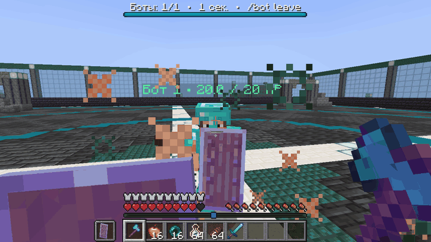
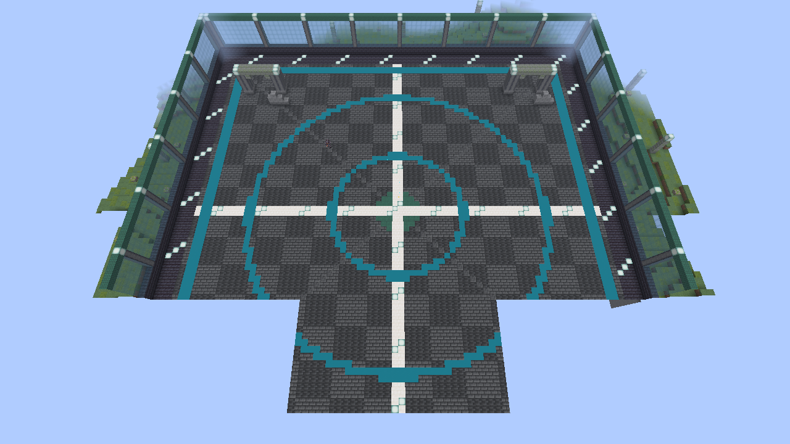
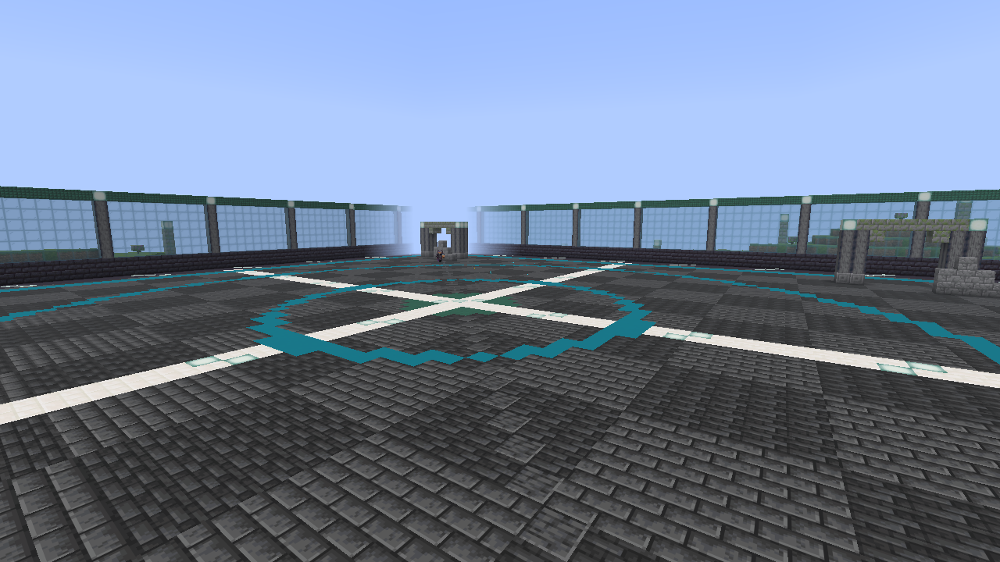
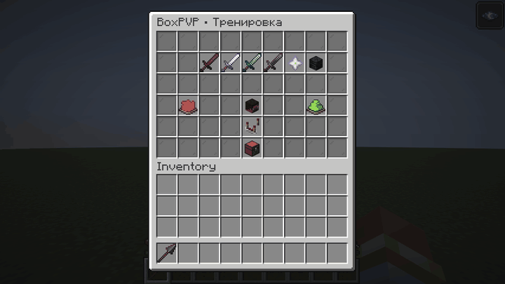
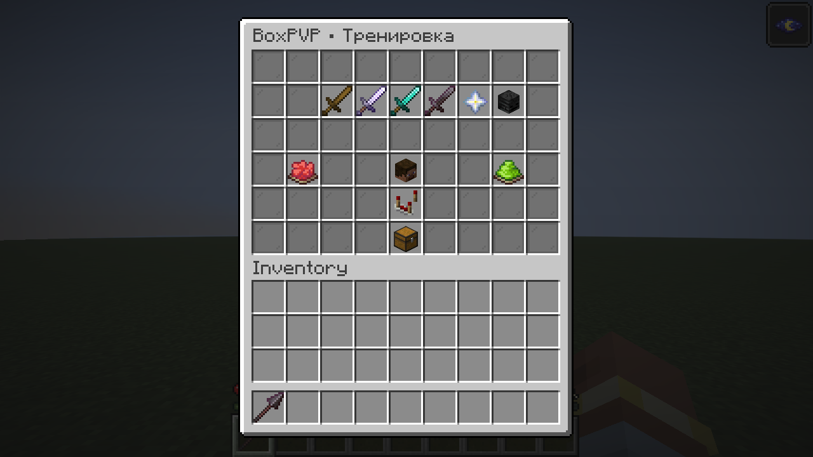
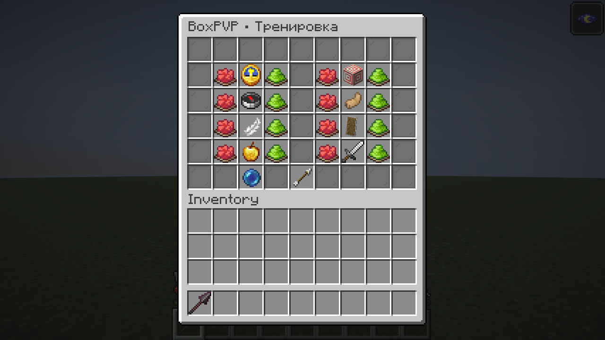
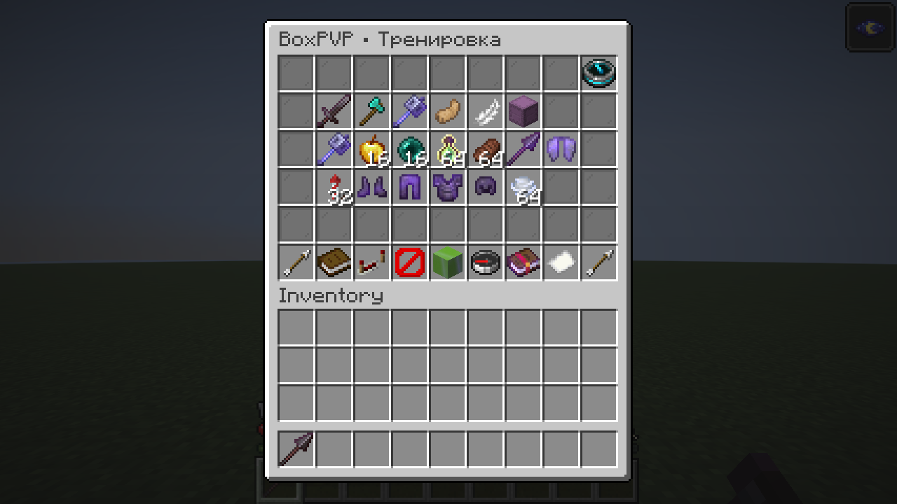

<div align="center">

<h1>BoxPVP</h1>

<p><strong>Тренируй криты, комбы, щит и серии булавой против ботов.</strong><br>Одиночный мир · от 1 до 8 противников · шесть сложностей · свои наборы</p>

<p><a href="https://github.com/HernoBeliEzh/BoxPVP/releases/latest"></a> &nbsp; <a href="https://t.me/Paranoikoff"></a></p>

[Установка](#установка) &nbsp;·&nbsp; [Наборы](#наборы) &nbsp;·&nbsp; [Настройки](#настройки) &nbsp;·&nbsp; [Команды](#команды) &nbsp;·&nbsp; [Что нового](CHANGELOG.md)

</div>

## Один `/bot` — и ты на арене

Выбери сложность, количество ботов и снаряжение в меню сундука. После трёхсекундного отсчёта начинается бой. Победи всех противников, повтори тренировку или включи автоповтор и веди счёт серии.

| Под свой уровень | Под свой стиль | Снова в бой |
| :--- | :--- | :--- |
| От «Лёгкой» до «Кошмара», точные значения через чат | Пять пресетов и сохранение собственного инвентаря | Автоповтор, победы, поражения и КД серии |

## Боты в действии

<div align="center">

<br>
<sub>Запись из Minecraft 1.21.11: набор «Топор», бот использует меч и щит.</sub>
</div>

- **Давление в ближнем бою.** Спринт-прыжки при преследовании, стрейф, контроль дистанции, криты и переключение на топор против щита.
- **Лечение с отходом.** Защитные перлы, обычные золотые яблоки, взрывные усиления и ремонт брони настоящими пузырьками опыта.
- **Преследование по ситуации.** Бот реагирует на броски перлов и убегающую цель, учитывает лечение и сохраняет часть запаса для защиты.
- **Воздушный бой.** Подброс зарядом ветра, серии булавой через «Порыв ветра III», рывок копьём, элитры и ракеты для возвращения к цели.

Боты — серверные искусственные игроки с человеческими моделями. Им не нужны аккаунты или внешние сервисы. Удары, дальность, кулдауны, прочность и расходники работают через ванильные механики. HP и поглощение видны над головой.

## Арена

<table>
  <tr>
    <td width="50%"></td>
    <td width="50%"></td>
  </tr>
  <tr>
    <td align="center"><b>80 × 80 блоков для боя</b><br>Кольца, руины, арки и освещение</td>
    <td align="center"><b>Отдельное измерение</b><br>Постоянный день и место для воздушных серий</td>
  </tr>
</table>

Границы и потолок удерживают участников внутри арены, включая попытки сменить измерение. Чанки загружаются заранее, площадка строится небольшими частями до телепортации. Выход — через меню или `/bot leave`.

## Настройки

<div align="center">

<br>
<sub>Обычный интерфейс сундука: выбирай предметами, задавай точные значения в чате.</sub>
</div>

**Лёгкая → Обычная → Сложная → Эксперт → Легенда → Кошмар.**<br>
На высоких сложностях боты быстрее реагируют, точнее наводятся и активнее двигаются. У «Легенды» и «Кошмара» нет дополнительной задержки реакции.

Нажми на компаратор, затем на нужную характеристику и введи значение в чат:

| Характеристика | Диапазон |
| :--- | :--- |
| Реакция | 0–60000 мс; шаг сервера — 50 мс |
| Погрешность наведения | 0–45° |
| Скорость поворота | 0,1–90° за тик |
| Вероятность крита, стрейф, щит | 0–100% |
| Порог лечения | 2–20 HP |
| Заряд перед ударом | 10–100% |

Ноль в реакции убирает дополнительную задержку. Для отмены ввода напиши `отмена`. Кнопки «−» и «+» тоже работают. Преследование перлов можно включить или отключить.

**Автоповтор** включается компасом справа вверху меню набора. Через пять секунд после результата начинается новый бой с теми же параметрами и свежим снаряжением. В чате — победы зелёным, поражения красным и КД серии; без поражений КД отображается как ∞. Выход сбрасывает серию.

<details>
<summary><b>Открыть скриншоты меню</b></summary>

| Параметры боя | Точная настройка ИИ |
| :---: | :---: |
|  |  |



</details>

## Наборы

| Набор | Снаряжение | Для чего |
| :--- | :--- | :--- |
| **OP** | Незерит З3, меч О4, 64 обычных золотых яблока, по 3 взрывных зелья силы II и скорости II на 1:30 | Меч, движение и давление |
| **Топор** | Алмаз З2, топор и меч О3, щит, 16 золотых яблок | Переключения оружия и игра против щита |
| **Булава** | Незерит З3, булава «Плотность V» / «Порыв ветра III», копьё «Рывок III», элитры, 32 ракеты, 64 заряда ветра, 16 золотых яблок | Подбросы, воздушные серии и сближение |
| **Криты** | OP-набор | Урон проходит только от ванильных критических ударов |
| **Комба** | OP-набор | Урон проходит только от обычных ударов без крита |

В каждом наборе также есть **16 перлов, 64 пузырька опыта и 64 стейка**. Оружие, броня и элитры имеют «Прочность III» и «Починку». Ракеты — полёта I, без взрывов. Игрок и каждый бот получают независимые копии; расходники конечны.

**Свой набор:** сохрани текущий инвентарь, броню и вторую руку командой `/bot kit save Название`. Сохраняются количество, зачарования, компоненты и прочность. Выбирай или удаляй набор в меню, задавай обычные правила, «Криты» или «Комбу».

<details>
<summary><b>Защита, острота и правила попаданий</b></summary>

Книга зачарований меняет защиту и связанную остроту: **З0 → О2 · З1 → О2 · З2 → О3 · З3 → О4 · З4 → О5**. Специальные зачарования булавы и копья сохраняются. Оригинал своего набора не изменяется.

Запрещённый удар в «Критах» или «Комбе» расходует обычный кулдаун, но не наносит урон и не отбрасывает. Ограничения одинаковы для игрока и ботов.

ИИ поддерживает мечи, топоры, булавы, копья и перечисленные расходники. Другие предметы своего набора сохраняются, но их автоматическое использование не гарантируется.

</details>

## Установка

1. Установи **Minecraft 1.21.11**, **Java 21** и **Fabric Loader 0.19.2+**.
2. Добавь **Fabric API 0.141.4+1.21.11** или более новую версию API для Minecraft 1.21.11.
3. Скачай JAR из [последнего релиза](https://github.com/HernoBeliEzh/BoxPVP/releases/latest) и положи его в `mods`.
4. Запусти одиночный мир и введи `/bot`.

При обновлении удали предыдущий JAR BoxPVP/FabricBase и перезапусти игру. Версии 0.2.x использовали ID `fabricbase`, начиная с 0.3.0 используется `boxpvp`; совместная установка заблокирована. Старые наборы и журналы восстановления продолжают читаться.

## Команды

| Команда | Действие |
| :--- | :--- |
| `/bot` | Открыть меню; во время боя — управление тренировкой |
| `/bot leave` | Завершить тренировку, остановить автоповтор и вернуться |
| `/bot kit save Название` | Сохранить текущую экипировку как свой набор |

## Твои вещи после боя

Перед тренировкой сохраняются исходные предметы, опыт, здоровье, голод, эффекты, режим игры, измерение и координаты. После боя или досрочного выхода состояние восстанавливается. При незавершённой тренировке восстановление выполняется после следующей загрузки мира.

<details>
<summary><b>Как хранятся данные</b></summary>

Журнал снимка остаётся в сохранении мира до подтверждённого сохранения восстановленного игрока. Временные предметы, снаряды и опыт очищаются между боями.

Данные находятся в папке `boxpvp` внутри мира. Миры с данными 0.2.x продолжают использовать прежнюю папку `fabricbase`.

</details>

## Разработка и проверки

**42 игровые проверки** для версии 0.3.1: наборы, один и восемь ботов, криты, кулдауны, щиты, расходники, булава, копьё, элитры, лечение, автоповтор, границы и восстановление после перезапуска. [Отчёт](docs/integration-results.txt) · [История изменений](CHANGELOG.md).

<details>
<summary><b>Собрать мод и запустить проверки</b></summary>

Нужна JDK 21. Gradle Wrapper включён в репозиторий.

```powershell
.\dev.ps1 build
.\dev.ps1 runClient
```

При настроенном `JAVA_HOME` на JDK 21:

```powershell
.\gradlew.bat build
.\gradlew.bat runClientGameTest
.\gradlew.bat runClientGameTest -PtestFocus=showcase
```

На Linux/macOS: `./gradlew build`. Мод появляется в `build/libs/`; тестовый код в релизный JAR не входит. Игровые проверки создают отдельный временный мир. Режим `showcase` снимает кадры для README в `build/run/clientGameTest/showcase`.

</details>

Первая версия рассчитана на одиночную игру. Сетевой режим, Crystal PvP и полный редактор предметов пока не реализованы.

---

<div align="center">

Сделано **[Paranoikoff](https://t.me/Paranoikoff)**<br>
[Telegram](https://t.me/Paranoikoff) &nbsp;·&nbsp; [Сообщить об ошибке](https://github.com/HernoBeliEzh/BoxPVP/issues) &nbsp;·&nbsp; [Скачать мод](https://github.com/HernoBeliEzh/BoxPVP/releases/latest)

</div>
