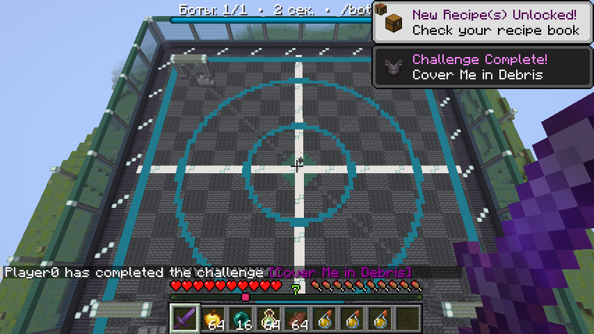

# BoxPVP

Автор: **Paranoikoff**.

PvP-тренажёр с ботами для одиночной Minecraft **1.21.11** на Fabric. `/bot` открывает меню сундука: выбери сложность, количество противников и набор.

[Скачать мод](https://github.com/HernoBeliEzh/BoxPVP/releases/latest) · [Сообщить об ошибке](https://github.com/HernoBeliEzh/BoxPVP/issues)



## Установка

1. Minecraft 1.21.11, Java 21 и Fabric Loader **0.19.2 или новее**.
2. Fabric API **0.141.4+1.21.11 или новее для 1.21.11**.
3. Положи `BoxPVP-0.3.0.jar` из Releases в `mods` и перезапусти игру.

При обновлении удали предыдущий JAR BoxPVP/FabricBase. Версии 0.2.x использовали ID `fabricbase`, версия 0.3.0 использует `boxpvp`. Их одновременная установка заблокирована. Старые наборы и журналы восстановления продолжают читаться.

## Управление

- `/bot` — меню; во время боя открывает управление тренировкой.
- `/bot leave` — завершить тренировку, остановить автоповтор и восстановить исходное состояние.
- `/bot kit save Название` — сохранить текущие предметы, броню и вторую руку как свой набор.

От одного до восьми ботов и шесть сложностей: **лёгкая, обычная, сложная, эксперт, легенда, кошмар**. Сложность меняет решения и управление; здоровье, предметы и дальность ударов остаются ванильными.

Компаратор открывает точные настройки. Нажми на характеристику и введи число в чат. Реакция задаётся в миллисекундах от 0 до 60000 с округлением вверх до игрового тика, равного 50 мс. Ноль убирает дополнительную задержку, вычисления остаются привязаны к тикам. Для отмены введи `отмена`. Неверное значение не меняет настройку. Кнопки «−» и «+» тоже работают.

Компас справа вверху меню набора включает **автоповтор**: новый бой через пять секунд после результата с теми же параметрами и свежим набором. Чат показывает победы зелёным, поражения красным и КД серии — отношение побед к поражениям; без поражений отображается ∞. Выход из тренировки сбрасывает серию.

## Наборы

| Набор | Состав |
|---|---|
| OP | Незерит З3, меч О4, 64 обычных золотых яблока, по три взрывных зелья силы II и скорости II на 1:30 |
| Топор | Алмаз З2, алмазные топор и меч О3, щит, 16 обычных золотых яблок |
| Булава | Незерит З3, булава «Плотность V» и «Порыв ветра III», незеритовое копьё «Рывок III», элитры, 32 ракеты полёта I без взрывов, 64 заряда ветра, 16 обычных золотых яблок |
| Криты | OP-набор; засчитываются только ванильные критические удары |
| Комба | OP-набор; критические удары не засчитываются |

Каждый набор также содержит 16 перлов, 64 пузырька опыта и 64 стейка. Оружие, броня и элитры имеют «Прочность III» и «Починку». Копии для игрока и ботов независимы, расходники конечны.

Книга зачарований меняет защиту и связанную остроту: З0 → О2, З1 → О2, З2 → О3, З3 → О4, З4 → О5. Специальные зачарования булавы и копья сохраняются. Сохранённый оригинал своего набора не изменяется.

Запрещённый удар в «Критах» или «Комбе» расходует кулдаун, но не наносит урон и не отбрасывает. Правила одинаковы для обеих сторон.

## Боты

Боты сближаются, стрейфят, выжидают заряд, выполняют криты, защищаются щитом и переключаются с меча на топор против щита. Союзники не наносят друг другу урон. HP и поглощение видны над головой.

Перед лечением бот пытается оторваться спринтом или защитным перлом, затем ест яблоко. Чужой бросок не прерывает еду и питьевые зелья своего набора. Взрывные усиления бот бросает под ноги. Перлы преследования используются по ситуации, чаще против убегающего игрока с низким HP. Между бросками есть пауза, часть запаса сохраняется для защиты. На сложной и более высоких сложностях бот пытается спастись перлом вниз при опасном падении, учитывая ванильную защиту после подброса и возможность удара булавой.

В наборе «Булава» копьё «Рывок III» помогает сблизиться на земле. Заряд ветра запускает первый подброс, а «Порыв ветра III» позволяет продолжить серию без нового заряда. Если в воздухе не хватает дальности до цели, бот надевает элитры, расходует ракеты и возвращает нагрудник перед атакой либо после посадки. Прочность и количество экипировки сохраняются.

Боты используют полезные зелья, едят при голоде и чинят броню с «Починкой» настоящими пузырьками опыта. Другие предметы своего набора сохраняются, но их автоматическое использование не гарантируется.

## Арена и сохранность

Площадка 80×80 из глубинного сланца с бирюзовыми кольцами, светящимися линиями, колоннами, стеклом, руинами, арками и рельефными озеленёнными островами вокруг находится в отдельном измерении. Высокие барьеры и потолок оставляют место для булавы и полёта. Сервер возвращает участников за границы, включая попытки сменить измерение. Выход — через меню или `/bot leave`.

Чанки загружаются заранее, арена строится небольшими частями до телепортации. При первом старте меню показывает подготовку; затем бой начинается автоматически. До старта исходные вещи остаются у игрока, ожидание можно отменить.

Перед заменой снаряжения сохраняются предметы, прочность, компоненты, опыт, здоровье, голод, эффекты, режим, измерение и координаты. Журнал удаляется после подтверждённого сохранения восстановленного игрока. После сбоя восстановление выполняется при следующей загрузке. Временные предметы, снаряды и опыт очищаются между боями.

Данные хранятся в папке `boxpvp` внутри мира; существующие миры с данными 0.2.x продолжают использовать прежнюю папку `fabricbase`.

## Сборка

Нужна JDK 21. Gradle Wrapper включён в репозиторий.

```powershell
.\dev.ps1 build
.\dev.ps1 runClient
```

При настроенном `JAVA_HOME` на JDK 21:

```powershell
.\gradlew.bat build
.\gradlew.bat runClientGameTest
```

На Linux/macOS: `./gradlew build`. Итоговый мод: `build/libs/BoxPVP-0.3.0.jar`.

Игровые проверки работают в отдельном временном мире и охватывают наборы, криты, восемь ботов, расходники, булаву, рывок, элитры, лечение, спасение от падения, ввод через чат, автоповтор, границы и восстановление после перезапуска. Отчёт: `build/run/clientGameTest/integration-results.txt`. Тестовый мод не включается в релизный JAR.

Сетевой серверный режим, Crystal PvP и полный редактор предметов не реализованы.